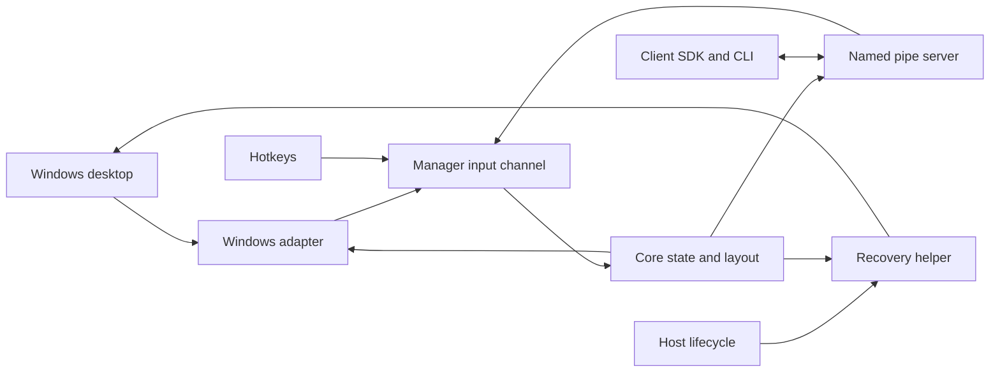

# Requirements

### Goal
Build a Windows-only, headless .NET tiling window manager alongside the cloned `glazewm` reference. Run in the logged-in user’s desktop session, optionally start at logon, and expose commands, state snapshots, and events to external applications over same-user named pipes.

### First release: tiling MVP
- Discover eligible existing windows and track creation, destruction, visibility, focus, title, geometry, and monitor changes.
- Tile windows using a horizontal/vertical split tree, configurable inner/outer gaps, directional focus/movement, and split resizing.
- Provide named workspaces with one visible workspace per monitor; switch workspaces and move windows between workspaces/monitors.
- Exclude shell, tool, transient, and explicitly ignored windows. Provide basic floating/tiling switching for dialogs and windows that should not tile; honor minimized and native fullscreen windows without implementing advanced fullscreen commands.
- Handle monitor removal, resolution/work-area changes, and mixed DPI without losing windows.
- Support configurable basic global shortcuts, pause/resume, redraw, and graceful shutdown through the same command handlers used by IPC.
- Publish stable window/workspace/monitor IDs and observable state suitable for a future status-bar widget.
- Supply a small .NET client library and CLI for queries, commands, event monitoring, and logon registration; neither requires a visualization UI.
- Restore manager-hidden windows on shutdown and unexpected host exit.

### Boundaries
No widget, tray UI, Windows service, browser bridge, or GlazeWM wire/config compatibility in the MVP. No administrator requirement; managing elevated windows is best-effort and reports access failures. The selected architecture is one manager host with separate projects and a narrowly scoped crash-recovery helper, not a second manager process.

Iteration two is a separate ordered task backlog, not a commitment to ship full parity in the MVP.

# Technical Design

### Reference implementation
The Rust workspace separates `wm`, `wm-platform`, `wm-common`, `wm-ipc-client`, `wm-cli`, and `wm-watcher`; no `.csproj` files currently exist.
- `glazewm/packages/wm/src/main.rs`: native listeners, IPC requests, cleanup, and manager events enter a serialized processing loop.
- `glazewm/packages/wm/src/wm_state.rs`: root → monitors → workspaces → split containers/windows.
- `glazewm/packages/wm/src/commands/window/manage_window.rs`: eligibility checks and window lifecycle handling.
- `glazewm/packages/wm/src/commands/general/platform_sync.rs`: apply pending native changes after state mutations.
- `glazewm/packages/wm-platform/src/platform_impl/windows/event_loop.rs`: native message loop and dispatching to its owning thread.
- `glazewm/packages/wm-common/src/{app_command.rs,wm_event.rs}`: command/query/event inventory.
- `glazewm/packages/wm-watcher/src/main.rs`: restore managed windows after unexpected manager termination.

Use these as behavioral references, not a line-by-line Rust translation. Review the reference license before copying or adapting implementation code.

### Project layout
Create a sibling `dotnet-wm/` directory, leaving `glazewm/` unchanged. Use .NET 10 LTS, nullable reference types, pinned dependencies, and Windows-targeted executables/native adapters.

```text
dotnet-wm/
  WinManager.sln
  src/
    WinManager.Contracts/       # versioned public DTOs and messages
    WinManager.Core/            # state, commands, layout, platform abstractions
    WinManager.Windows/         # CsWin32 adapters, native thread, NativeMethods.txt
    WinManager.Host/            # headless WinExe, composition, config, pipe server
    WinManager.Client/          # reusable pipe client
    WinManager.Cli/             # commands, queries, event monitor, startup registration
    WinManager.Recovery/        # narrow recovery executable
  tests/
    WinManager.Core.Tests/
    WinManager.Ipc.Tests/
    WinManager.Windows.Tests/
  docs/
    protocol.md
    iteration-2.md
```

`Core` has no generated Win32 dependencies. `Host` composes `Core` and `Windows` through dependency injection; `Client` depends only on public contracts. Start with validated JSON configuration for workspace definitions, monitor assignment, gaps, ignores, and simple shortcuts. GlazeWM YAML import is deferred.

### Native integration and processing
Use `Microsoft.Windows.CsWin32` as a private build dependency in `Windows`; request APIs explicitly in `NativeMethods.txt`. Keep generated types and unsafe code behind managed abstractions. Typical API groups include window/monitor enumeration, `SetWinEventHook`, message-loop functions, `RegisterHotKey`, `SetWindowPos`/deferred positioning, `ShowWindow`, `SetForegroundWindow`, and DWM geometry/cloaking queries. See [Microsoft’s CsWin32 guidance](https://learn.microsoft.com/en-us/windows/apps/develop/interop/call-win32-apis).

A dedicated native thread owns rooted callback delegates, hooks, hotkeys, and a hidden top-level notification window with `GetMessage`/`DispatchMessage`; do not rely on a message-only window for broadcast display notifications. Native callbacks only capture lightweight notifications and enqueue them. Dispatch native operations through an explicit adapter; never block callbacks on client writes or window inspection.

A single-reader `Channel<ManagerInput>` owns mutable manager state. Install hooks before initial enumeration, then reconcile buffered events and periodically rescan to close discovery races. Coalesce noisy geometry notifications; overload requests a full reconciliation instead of silently losing lifecycle state. IPC admission is bounded and can return `busy`.

Platform contracts, with concrete records introduced during implementation:
```csharp
public interface IWindowPlatform
{
    Task<DesktopSnapshot> CaptureAsync(CancellationToken ct);
    Task<ApplyResult> ApplyAsync(LayoutPlan plan, CancellationToken ct);
}
```

Maintain a split tree and stable GUID identities, with HWNDs confined to the platform mapping. Check HWND plus process identity before acting because handles can be reused. Compute deterministic physical-pixel layouts from monitor work areas with DPI-aware gap conversion, minimum-size constraints, and rounding remainder distribution. Run per-monitor-v2 DPI awareness before native initialization. Observe actual geometry/focus after best-effort application; failed native actions must not be reported as successful physical changes. Track intended manager hides separately from application hides/minimization and suppress feedback loops through reconciliation, not by discarding all self-generated events.

### External protocol
Use duplex `NamedPipeServerStream` connections with same-user restrictions, a user-and-session-specific pipe name, and a per-session single-instance lock. Validate local-client access, cap message size/client counts, and document that all authorized same-user clients can control managed windows.

Use a length-prefixed UTF-8 JSON protocol with `protocolVersion`, `kind`, and request correlation IDs. Do not expose arbitrary shell execution in the MVP. Validate typed command targets and arguments before execution.

```csharp
public sealed record RequestEnvelope(
    int ProtocolVersion, Guid RequestId, string Operation, JsonElement Payload);
public sealed record EventEnvelope(
    int ProtocolVersion, Guid InstanceId, long Sequence,
    long StateRevision, string EventType, JsonElement Payload);
```

Responses include request ID, success/error code, and committed state revision. DTOs describe monitors, workspaces, split nodes, windows, focus, pause status, physical geometry, and window mode. Provide `query.snapshot`, filtered `subscribe`/`unsubscribe`, focus/move/resize/workspace commands, floating/tiling switching, pause, redraw, and exit.

Create subscriptions atomically in the manager loop: enqueue an initial snapshot at revision R before events newer than R. This avoids the separate query-then-subscribe race. Events include window managed/unmanaged/updated, focus changed, monitor added/removed/updated, workspace activated/deactivated/updated, layout changed, pause changed, and application exiting. Use monotonic per-instance event sequences and state revisions; no durable replay in the MVP. Reconnection always obtains a fresh snapshot and instance ID. Bound each client’s output queue and disconnect lagging clients rather than blocking the manager or silently dropping events. The client library demultiplexes responses/events and exposes async subscription consumption.

### Lifetime and recovery
Run `Host` as a `WinExe` in the interactive user session; a Session-0 service cannot replace this. Add explicit CLI install/uninstall-startup commands using per-user logon registration, defaulting to normal privilege. Store validated configuration and rotating logs under a per-user application-data directory.

Before hiding a workspace window, register its HWND/process identity and original recoverable state with `Recovery` and await acknowledgment. The helper monitors the host process lifetime, not merely a public client disconnect; on host failure it restores surviving, identity-matched windows. If the helper cannot start or acknowledge registration, refuse unsafe hiding. Graceful shutdown restores affected windows before notifying the helper that cleanup completed. Core initialization must also tolerate stale recovery records after interrupted launches.

### Architecture


The host owns composition and lifetime. Core serializes state changes, the adapter owns native resources, and the pipe server only validates/transports requests and committed observations.

# Testing

### Automated validation
- Use fake platform adapters to test deterministic split layouts, gaps, minimum sizes, negative monitor coordinates, DPI conversion, directional focus, resize bounds, floating exclusions, and workspace membership invariants.
- Test event normalization with duplicate/out-of-order notifications, destroyed/reused HWNDs, self-induced hide events, monitor removal, and native action failures.
- Test real named-pipe connections for framing across partial reads, invalid/oversized messages, version mismatch, correlated responses interleaved with events, multiple subscribers, atomic snapshot ordering, slow-client isolation, and fresh snapshots after reconnect.
- Use Windows-only integration tests that create disposable test windows and verify enumeration, native hooks, focus/geometry changes where Windows permits them, hide/show restoration, and hotkey resource cleanup. Assert structured failure when foreground restrictions prevent focus.
- Launch the actual host and recovery helper against test-owned windows; terminate the host and verify hidden windows are restored without affecting unrelated or identity-mismatched windows. Test helper-start failure and refusal to hide.
- Validate startup-registration commands against a disposable registration target; verify single-instance behavior and clean cancellation/resource disposal.

Desktop-dependent tests run only in an isolated interactive Windows session, not on a developer’s ordinary desktop or a Session-0 CI agent. Simulate monitor/DPI topologies in core tests where real hardware cannot be provisioned. Build/publish the headless host and CLI and run an end-to-end CLI snapshot → subscribe → command → event smoke test. No status-bar widget is needed for validation.

# Iteration Two

### Ordered follow-up task list
Track these as separate follow-up implementation tasks in `dotnet-wm/docs/iteration-2.md`, grounded in the cloned command/config inventory. Each task adds corresponding command contracts, events, client support, and automated coverage. This is functional Windows parity work, not a promise of byte-for-byte GlazeWM compatibility.

1. **Advanced layouts and interaction:** finish split/container selection semantics, focus cycling with mode filters, absolute/percentage sizing and positioning, border adjustment, drag-to-reorder/resize behavior, and advanced tiling-direction operations. Reference `packages/wm/src/commands` and `wm-common/src/app_command.rs`.
2. **Complete workspace behavior:** previous/recent/next-active navigation, refocus toggling, keep-alive workspaces, persistent monitor bindings and hotplug migration, moving whole workspaces, display names, and live workspace-config updates. Reference `wm_state.rs`, workspace/monitor commands, and README workspace configuration.
3. **Full window-state controls and effects:** complete floating placement/centering/topmost options; fullscreen/maximized/minimized toggles; title-bar visibility; opacity, focus borders, corners, taskbar behavior, and restoration of altered native properties. Gate unsupported DWM effects by OS capability. Reference `platform_sync.rs`, `app_command.rs`, and README window-behavior/effects sections.
4. **Rules, configuration, and keyboard parity:** process/class/title equals/regex matching, rule triggers and run-once behavior, multiple commands per binding, named binding modes, extended keyboard layouts/chords, transactional reload with rollback, configurable default states, percentage gaps, and optional GlazeWM YAML import. Reference `manage_window.rs`, `wm-common/src/parsed_config`, and README configuration sections.
5. **Automation and pointer behavior:** focus-follows-cursor, cursor jump triggers, configurable startup/shutdown/reload hooks, and opt-in shell-exec commands with an explicit security model. Reference the listeners in `packages/wm/src/main.rs` and general commands.
6. **Distribution and ecosystem integration:** signed installer/upgrades/uninstall cleanup, package-manager distribution, optional tray control as a separate client, and an optional authenticated WebSocket adapter reusing the protocol if web widgets require it. Document the event catalogue, capability negotiation, and migration policy as new features arrive.

### Intentional exclusions
The status-bar widget remains a separate project. Zebar bundling, macOS support present in this clone, and exact GlazeWM CLI/IPC compatibility are not required for this Windows .NET application. Treat the inventory as a checklist against the cloned version; recheck it before calling iteration two complete.

# Delivery Steps

### ✓ Step 1: Implement native desktop observation and host bootstrap
A headless host discovers eligible windows and monitors and receives normalized native notifications.
- Create the sibling solution and `Contracts`, `Core`, `Windows`, and `Host` projects with pinned .NET/CsWin32 setup.
- Implement the dedicated native message thread, window/monitor discovery, hooks, callback lifetime management, display notifications, and safe cleanup.
- Add eligibility filtering, identity-safe HWND mappings, buffered startup reconciliation, and periodic rescanning.
- Verify discovery and notification handling using fake adapters and disposable native test windows.

### ✓ Step 2: Implement deterministic tiling and window commands
The core serializes inputs and computes/applies basic split layouts with focus, movement, and resizing.
- Implement the manager input channel, state tree, pending layout plans, bounded admission, and native failure reconciliation.
- Add horizontal/vertical splits, configurable gaps, directional focus/move, split resize, and basic floating/tiling transitions.
- Respect work areas, mixed DPI, minimum sizes, minimized/fullscreen exclusions, and feedback-loop handling.
- Cover layout invariants and geometry/focus failures with core tests and native smoke tests.

### ✓ Step 3: Implement workspaces with safe visibility recovery
Windows can move between per-monitor workspaces without becoming stranded after a host crash.
- Add workspace assignment, switching, window transfers, monitor removal migration, and display-change relayout.
- Implement the `Recovery` helper, identity-checked restore records, registration acknowledgment before hiding, and host-process lifetime monitoring.
- Distinguish manager-hidden windows from application-hidden/minimized windows; fail safely if recovery is unavailable.
- Verify workspace transitions, hotplug simulations, graceful restoration, and forced-host-exit recovery against test-owned windows.

### ✓ Step 4: Expose named-pipe commands, subscriptions, and client tools
External applications can query state, issue commands, and maintain a race-free event-driven view.
- Add the same-user/session named-pipe server, bounded length-prefixed JSON framing, validation, correlation, and structured errors.
- Implement versioned DTOs/events, atomic snapshot-plus-subscription ordering, sequence/revision tracking, and slow-client disconnection.
- Create `Client` and `Cli` projects for querying, command invocation, filtered event monitoring, and reconnection with fresh snapshots.
- Document the protocol and test multi-client ordering, malformed frames, disconnects, overload, and end-to-end command/event flows.

### ✓ Step 5: Complete user-session operation and configuration
The MVP runs reliably at user logon with configurable controls and no visualization UI.
- Add validated JSON configuration, basic registered shortcuts, pause/redraw/exit controls, rotating logs, and per-session single-instance protection.
- Implement explicit CLI install/uninstall-startup commands and headless Windows publishing.
- Coordinate cancellation, native-resource disposal, public exiting events, window restoration, and recovery-helper completion.
- Verify startup registration against disposable targets and run an isolated interactive-session smoke test.
- Record the ordered follow-up tasks from the Iteration Two tab in `docs/iteration-2.md`; do not implement those deferred features in the MVP.