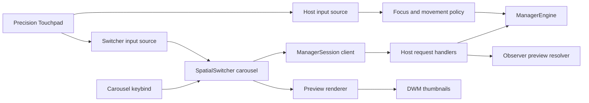

# Requirements

### Agreed behavior

Native touchpad support is configurable and **enabled by default**. Keyboard shortcuts remain available; native gestures must not depend on users mapping gestures to shortcuts in Windows Settings.

| Input | Owner | Action |
|---|---|---|
| Three-finger left/right | Host | Inverted directional focus: left swipe → `Focus Right`; right swipe → `Focus Left` |
| Four-finger directional swipe | Host | `MoveSpatial` in the physical swipe direction, reusing Shift-modified shortcut semantics |
| Three-finger up | SpatialSwitcher | Open the carousel for the current workspace on the captured foreground monitor |
| Three-finger down | SpatialSwitcher | Close the carousel **without accepting** its highlighted window |
| Two-finger horizontal scrolling | SpatialSwitcher | Scroll the carousel continuously, only while it is open |
| Carousel keybind | SpatialSwitcher | Open/close the same carousel; proposed default `Ctrl+Alt+Space` |
| Enter / preview click | SpatialSwitcher | Accept the selected window through the existing Host focus command |
| Escape | SpatialSwitcher | Cancel and return to the original application when still available |

Three-finger vertical gestures never become directional focus commands. Four-finger movement uses the existing `MoveSpatial` behavior, including its floating/workspace-transfer semantics—not a new drag or tile-swap implementation.

### Presentation

- **First deliverable: a DWM live-thumbnail experiment inside SpatialSwitcher.**
- Show a non-overlapping horizontal strip of window cards. Fit each preview inside a box approximately half the monitor work-area width and height, preserving aspect ratio.
- Include eligible tiled and floating windows from the captured workspace. Inactive/minimized candidates may use clearly identified placeholders when a live preview is unavailable.
- Scrolling changes only the highlighted selection and strip position. Application focus changes only on acceptance; cancelling returns to the original application.
- Never resize, minimize, hide, or rearrange source windows to construct the carousel. Directional focus outside the carousel retains existing manager behavior.
- Treat sizing, spacing, easing, and selection decoration as an initial presentation to iterate on, not a finished Task View clone.

### Boundaries

- Host owns actual window-changing gesture bindings. SpatialSwitcher owns carousel input and presentation independently.
- No Host-to-switcher gesture events, launch commands, or new Host-owned UI. SpatialSwitcher must be running for its native gestures/keybind to work; Host gestures work independently.
- No new configuration UI or automatic registry changes. Document settings and compatibility; a future configuration UI can explain them.
- No GPU capture pipeline, arbitrary transformation of other applications’ composition trees, driver installation, or elevation in this iteration.

### Feasibility condition

Native contact capture and suppression of Windows’ built-in gestures are separate problems. The implementation must prove both on supported configurations; it must not claim exclusive ownership merely because `WM_INPUT` arrives. If supported user-mode mechanisms cannot prevent conflicting shell actions, record that as a blocker/unsupported capability rather than silently requiring manual mappings or running duplicate actions.

# Technical Design

### Existing implementation

- `WinManager.Host/ManagerConfiguration.cs` maps directional shortcuts to `Focus` and Shift-modified shortcuts to `MoveSpatial`.
- `WinManager.Host/Program.cs` runs `ShortcutService`, forwarding commands to the serialized `ManagerEngine` command path. Gesture actions should use the same path without synthesizing keystrokes.
- `WinManager.Windows/WindowsDesktopObserver.cs` owns native observation and `WindowIdentityMap`; the latter resolves managed IDs to native identities on the observer thread.
- `WinManager.SpatialSwitcher/SpatialApplication.cs` already runs a persistent Avalonia tray process. `SwitcherWindow.cs`, `PopupPlacement.cs`, and `SpatialSwitcherPresentation.cs` provide context capture, placement, workspace grouping, and connection lifecycle patterns.
- `CurrentWorkspaceWindow.cs` currently renders metadata cards, not live previews. Preserve it and the existing switchers while adding a dedicated carousel window.
- `WindowInfo` intentionally has no native handle. `ManagerSession` already provides client-initiated requests and snapshot subscriptions over the existing local pipe.

### Ownership and flow

Share native input/recognition code in `WinManager.Windows`, but instantiate independent sources in the Host and SpatialSwitcher. Each process owns one touchpad registration and a different action policy; there is no cross-process gesture stream.



The diagram’s Host responses are ordinary request results and existing snapshots, not new gesture/action notifications. Do not have the Host launch SpatialSwitcher.

### Native input and action policies

- Prototype Precision Touchpad HID registration (`Digitizers`, usage `Touch Pad`) with `RegisterRawInputDevices`, background delivery, and device-change handling. Confirm actual contact reports exist on the device; mouse messages alone do not prove finger-count support.
- Decode using HID descriptors/preparsed data rather than device-specific byte offsets. Assemble complete frames across reports, track contact IDs, normalize coordinates, and reject malformed/out-of-range input.
- Keep native callbacks small. Publish bounded frames, coalesce continuous updates, and cancel recognition if input is lost rather than interpreting dropped data as a completed swipe.
- The recognizer tracks begin/update/end/cancel, finger-count settling, dominant axis, minimum travel, and device/time discontinuities. Commit at most one discrete action per completed swipe; avoid three-finger focus firing during a four-finger gesture’s contact transitions.
- Host policy handles only three-finger horizontal focus and four-finger directional movement. Resolve/validate the managed foreground target and send existing typed commands. Do not issue background focus/movement while SpatialSwitcher owns foreground interaction.
- Switcher policy handles three-finger vertical entry/dismissal, plus continuous two-finger horizontal movement while the carousel is open. Do not install a global mouse-wheel suppression hook. Use one canonical scrolling source so translated wheel events do not double-apply native deltas.
- Test native contact availability and shell-action coexistence early. Keep a capability result distinguishing disabled, unsupported device, registration/decoding failure, gesture-conflict blocker, and available. Do not use blanket keyboard suppression as a substitute for owning touchpad gestures.

### DWM renderer and preview lookup

Start with `DwmRegisterThumbnail`, `DwmQueryThumbnailSourceSize`, `DwmUpdateThumbnailProperties`, and deterministic `DwmUnregisterThumbnail` cleanup. The carousel’s owned top-level native window is the thumbnail destination; source windows stay untouched behind it.

Expose a small renderer boundary supporting source binding, destination/source rectangles, opacity/visibility, and release. Keep thumbnail interop in `WinManager.Windows`; keep selection/layout and Avalonia integration in SpatialSwitcher. This permits later replacement without building a capture backend now.

A bounded client-initiated `query.previewTargets` operation resolves managed IDs to short-lived source identities. It accepts known managed window IDs, not arbitrary caller-supplied handles. Resolve on the observer’s native thread, validate lifecycle/process identity, and return per-window failures rather than failing the whole carousel. Re-resolve on relevant snapshot changes and validate immediately before thumbnail registration.

Proposed wire contracts use fixed-width numeric values rather than serialized pointers:

```csharp
record PreviewTargetsRequest(IReadOnlyList<Guid> WindowIds);
record WindowPreviewTarget(Guid WindowId, long HandleValue,
    uint ProcessId, ulong ProcessCreationTime);
record PreviewTargetFailure(Guid WindowId, string Code);
record PreviewTargetsResult(long StateRevision,
    IReadOnlyList<WindowPreviewTarget> Targets,
    IReadOnlyList<PreviewTargetFailure> Failures);
```

Extend existing strict request validation, client validation, same-user/session pipe protections, frame limits, and source-generated JSON metadata. This is preview plumbing, not a new `ManagerCommand` or a change to `WindowInfo`.

The experiment must establish top-level destination compatibility, Avalonia/native layering, DPI conversion, clipping, and smooth rectangle updates. Keep labels/borders outside thumbnail content initially; DWM thumbnails are not normal Avalonia image controls. Protected, minimized, inaccessible, or unrenderable sources get placeholders without restoring/unhiding them. Stop at this boundary if the experiment shows DWM cannot support the intended strip; a capture-based replacement requires a separate decision.

### Carousel state and configuration

- Model closed/opening/open/closing and keep state independent of existing modifier-release switcher acceptance behavior.
- Capture workspace, monitor, original window, and initial selection before the overlay activates. Pin that context until dismissal; do not recapture the overlay as the target.
- Scroll by accumulated horizontal offset, clamp at strip ends, and optionally settle the nearest card under a selection anchor. Never wrap unexpectedly or activate applications while browsing.
- Accept with `ManagerCommand(Focus, WindowId: selectedId)`. Cancel restores only the original valid target; external application activation closes without stealing focus back.
- Close safely on manager disconnect, changed workspace view, monitor removal, disablement, or shutdown. Remove closed windows, preserve selection by ID, and release stale thumbnails.
- Add a shared, source-generated touchpad settings model, exposed as `touchpad.enabled: true` in `ManagerConfiguration`. Validate bounded recognition tuning values if exposed. SpatialSwitcher reads the same configuration through its existing client path; retain restart-to-apply semantics and document restarting both processes. Keyboard fallback remains usable when native input is disabled or unsupported.

### File map

| Area | Planned additions / changes |
|---|---|
| `src/WinManager.Windows/` | Add `TouchpadInputSource.cs`, HID frame decoding/recognition types, `DwmThumbnailRenderer.cs`, and observer preview-resolution support; update native API declarations |
| `src/WinManager.Host/` | Add `GestureService.cs`; update `Program.cs`, `ManagerConfiguration.cs`, JSON context, and `PipeServer.cs` for settings, command dispatch, and preview queries |
| `src/WinManager.Contracts/` | Add `TouchpadOptions.cs` and `PreviewTargets.cs`; update `ProtocolJsonContext.cs` |
| `src/WinManager.Client/` and `src/WinManager.Ui/` | Extend `WinManagerClient.cs`, relevant validation, and `ManagerSession.cs` for preview lookup/settings consumption |
| `src/WinManager.SpatialSwitcher/` | Add `CarouselWindow.cs`, `CarouselPresentation.cs`, and local gesture controller; update application/window lifecycle, keyboard policy/hook, and project references |
| `tests/WinManager.Windows.Tests/` | Add HID, recognition, source lifecycle, and native preview harness coverage |
| `tests/WinManager.Ipc.Tests/` | Extend configuration/client/pipe/SpatialSwitcher tests; add carousel state and presentation tests |
| `docs/` | Update `configuration.md`, `protocol.md`, and `validation.md`; explain native capability limits separately from legacy manual mappings |

### Principal risks

- **Exclusive gesture ownership is unproven:** native functionality is capability-gated; no unsupported promise of plug-and-play suppression.
- **Cross-process input observation:** verify both processes can receive their required frames concurrently; register once per process and partition actions by policy.
- **DWM restrictions:** prototype real composed output early; avoid assuming arbitrary transforms, effects, or reliable minimized-window animation.
- **Stale identities and graphics resources:** validate native source identity, handle destruction races, and release thumbnails on every exit path.

API references: [Raw Input overview](https://learn.microsoft.com/en-us/windows/win32/inputdev/about-raw-input), [DWM thumbnail overview](https://learn.microsoft.com/en-us/windows/win32/dwm/thumbnail-ovw).

# Testing

### Agent-executable validation

- Use existing xUnit suites and add deterministic HID frame/gesture fixtures. Exercise valid and malformed descriptors/reports, multi-report frames, finger-count transitions, diagonal jitter, insufficient travel, cancellation, disconnect, queue overflow, and device reattachment.
- Assert three-finger horizontal inversion, four-finger movement direction, vertical routing only to SpatialSwitcher, one action per swipe, no synthetic keystrokes, and no Host window actions when the switcher is foreground.
- Extend `HostConfigurationTests`, client validation, and pipe tests for default-on/backward-compatible settings, invalid options, bounded preview queries, unknown IDs, unavailable operations on older Hosts, and source-generated serialization.
- Test carousel opening/context capture, stable non-overlapping geometry, aspect-ratio fitting, scroll bounds, selection preservation, cancellation versus acceptance, key repeat handling, and cleanup during disconnect/window closure/monitor removal.
- Use fake native adapters to assert balanced thumbnail registration/unregistration and that carousel browsing never calls source resize/hide/minimize operations.
- Add a Windows interactive harness using controlled test windows to verify preview registration, source geometry preservation, close/reopen cycles, and failure placeholders. Check composed output where desktop capture is available; Avalonia-only screenshots may omit DWM thumbnails.
- Build affected projects and run applicable existing/new tests, including current shortcut, spatial command, and switcher regressions. Preserve NativeAOT/source-generation compatibility for touched Host/contract paths.

### Evidence limits

Synthetic reports prove recognition logic, not the physical device’s report availability or absence of Windows shell actions. The native diagnostic probe must retain these as explicit capability outcomes; if the execution environment cannot establish them, report native ownership as unverified/blocked rather than passing it on the basis of mocked tests.

# Delivery Steps

### ! Step 1: Build the DWM carousel experiment and preview lookup
SpatialSwitcher can display a non-overlapping strip of live previews without changing source-window geometry.
- Add the bounded client-initiated preview-target query across Contracts, Client, Ui, Host pipe handling, and the Windows observer identity resolver.
- Add the replaceable DWM renderer and an experimental `CarouselWindow` using existing monitor/workspace context helpers.
- Fit aspect-preserving previews into half-work-area card bounds and provide placeholders for unavailable sources.
- Add protocol/identity/resource-lifecycle tests and a controlled Windows preview harness to establish layering, clipping, DPI behavior, and untouched source geometry before further presentation work.

### ! Step 2: Implement reusable native touchpad capture and recognition
Both processes can independently consume normalized touchpad frames with explicit capability diagnostics.
- Add the raw-input source, descriptor-driven HID decoder, frame assembly, and gesture state machine in `WinManager.Windows`.
- Support three-/four-finger discrete swipes and two-finger continuous horizontal displacement with cancellation and bounded buffering.
- Probe concurrent background input delivery and conflicting Windows gesture behavior; capability-gate unsupported ownership rather than introducing manual shortcut setup or silent duplicate actions.
- Add deterministic decoding/recognition fixtures and lifecycle tests for malformed reports, contact transitions, dropped frames, and device removal.

### ! Step 3: Bind Host-native focus and movement gestures
The Host executes native three-finger focus and four-finger movement through existing command handlers.
- Add default-on validated touchpad settings and source-generated serialization, maintaining compatibility with configuration files that omit the new section.
- Add `GestureService` registration in `Program.cs`, mirroring `ShortcutService` dispatch without synthesized keys or Host-to-switcher events.
- Map three-finger horizontal gestures inversely to `Focus` and four-finger directional gestures directly to `MoveSpatial`.
- Gate actions on managed foreground context and input capability; preserve keyboard operation when gestures are unavailable.
- Extend configuration and command-policy tests and document the new mappings and restart semantics.

### ! Step 4: Add SpatialSwitcher-owned native carousel entry and selection
Native three-finger up/down and a local keybind open or cancel the carousel without Host-driven UI events.
- Integrate an independent native source and local vertical-gesture policy into `SpatialApplication`/switcher lifecycle.
- Add the carousel keybind through existing keyboard policy/hook patterns without changing existing switcher acceptance semantics.
- Capture and retain original workspace/monitor/window context, select by stable ID, and accept via existing client-to-Host `Focus` commands.
- Cancel on swipe down or Escape; handle external activation, disconnect, empty workspaces, and source closure safely.
- Add routing and state-machine tests proving no focus changes during browsing and no accidental acceptance on dismissal.

### ! Step 5: Add two-finger scrolling and resilient presentation
The open carousel scrolls smoothly through non-overlapping previews and cleans up reliably under desktop changes.
- Connect native two-finger horizontal deltas to bounded strip offset and optional settle animation, coalescing renderer updates to UI frames.
- Ensure translated pointer/wheel events cannot double-apply scrolling or leak to applications beneath the overlay.
- Preserve selection across snapshot changes and release/rebind thumbnails when windows disappear, identities change, or the monitor/view is invalidated.
- Tune initial spacing, preview sizing, and external selection decoration within the DWM experiment’s established limits.
- Add geometry/scroll/cleanup tests, run existing switcher and spatial-navigation regressions, and document measured DWM/native-input limits and deferred composition enhancements.

### ✓ Step 6: Restore three-finger gesture propagation to SpatialSwitcher
Recognized touchpad frames reach the carousel policy across timestamp-coalesced reports and all detected touchpads, while preserving the Host's suppression safety gate.
- Accept equal frame timestamps and maintain independent frame assembly and recognition per device.
- Separate local contact recognition from verified exclusive gesture ownership, and route carousel actions on the UI thread.
- Add timestamp, multi-device, policy-routing, capability, and explicit shell-conflict-warning regressions; document the remaining hardware limitation.